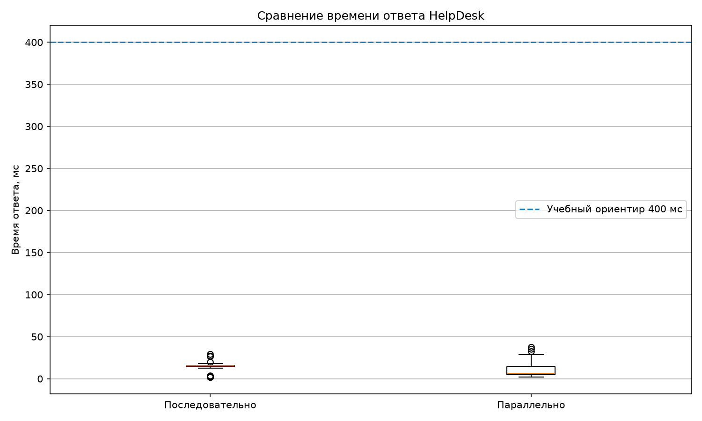
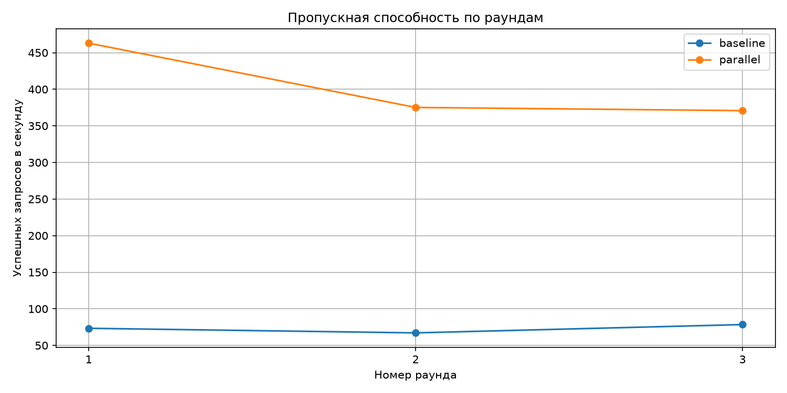

# Исследование производительности HelpDesk

## 1. Цель исследования

Определить влияние параллельных HTTP-запросов
на производительность API.

## 2. Условия эксперимента

Операция: GET /tickets?limit=20&offset=0.

Последовательный режим: один клиентский поток.

Параллельный режим: до пяти клиентских потоков.

Каждый режим выполнялся три раза.

## 3. Результаты

| Показатель | Последовательно | Параллельно |
|---|---:|---:|
| Запросов | 90 | 90 |
| Успешных запросов | 90 | 90 |
| Среднее время, мс | 13.72 | 10.32 |
| Медиана, мс | 15.30 | 6.69 |
| P95, мс | 23.44 | 26.41 |
| Успешных запросов в секунду | 72.69 | 398.84 |
| Доля неуспешных попыток, % | 0.00 | 0.00 |
| Успешных за 400 мс, % от всех попыток | 100.00 | 100.00 |

## 4. Изменение показателей

Изменение P95: **+12.68%**.

Изменение пропускной способности: **+448.72%**.

## 5. Визуализация результатов

## 6. Проверка гипотезы

Устойчивая закономерность увеличения времени ответа не выявлена.

Раундов с доступными результатами P95: 3.

Раундов с увеличением P95: 2.

Раундов с уменьшением P95: 1.

## 7. Рекомендации

Продолжить исследование при большей нагрузке и более длительном наблюдении.

## 8. Ограничения исследования

Эксперимент проведён в локальном окружении.

Использовались короткие серии запросов.

Исследовалась одна операция API.

Результаты характеризуют конкретные условия эксперимента.
Проверка гипотезы носит описательный характер.

Для оценки эксплуатационной производительности
необходимы дополнительные измерения.
