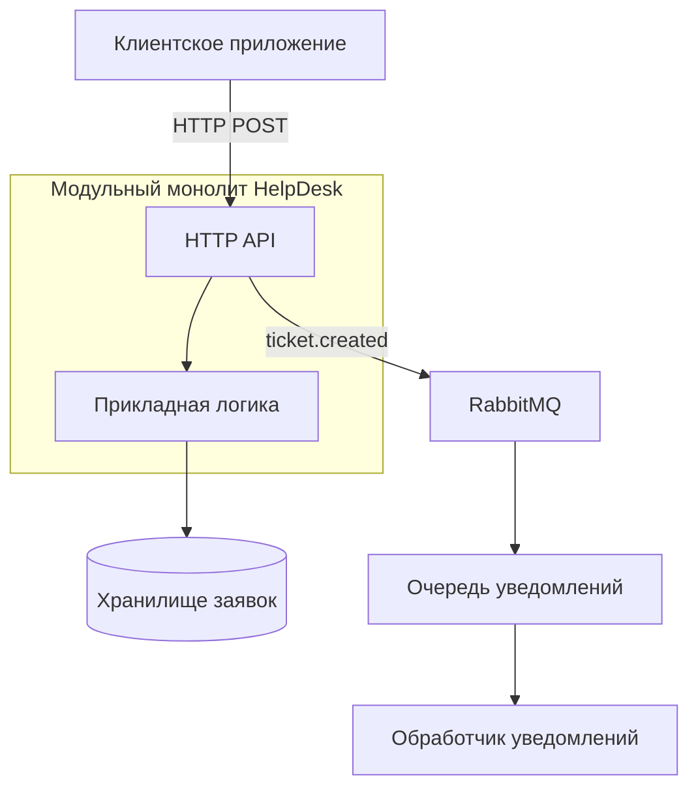

# Интеграционная модель HelpDesk

## Синхронное взаимодействие

Источник: пользовательское приложение.

Получатель: HTTP API HelpDesk.

Операция: создание заявки.

Результат: подтверждение создания и идентификатор заявки.

## Асинхронное взаимодействие

Источник: приложение HelpDesk.

Брокер: RabbitMQ.

Очередь: helpdesk.notifications.

Тип сообщения: ticket.created.

Получатель: обработчик уведомлений.

Результат: обработка события создания заявки.

## Диаграмма взаимодействия



## Принятые решения

Создание заявки выполняется синхронно через HTTP API.

Уведомления обрабатываются асинхронно через RabbitMQ.

Основная предметная логика находится внутри
модульного монолита.

Обработчик уведомлений запускается отдельно.

## Ограничения учебной реализации

Публикация сообщения происходит после сохранения заявки.

При ошибке публикации заявка может остаться сохранённой
без соответствующего сообщения.

Сохранение данных в JSON рассчитано на
последовательную работу учебного приложения.

```

```
