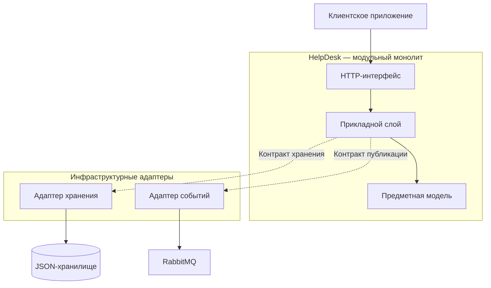

# Архитектура приложения HelpDesk

## Архитектурный подход

Модульный монолит с разделением ответственности
по архитектурным слоям.

## Основные компоненты

- HTTP-интерфейс — приём запросов и выдача ответов.
- Прикладной слой — выполнение сценариев приложения.
- Предметная модель — объекты и правила их поведения.
- Инфраструктура — хранение данных и внешние интеграции.

## Схема компонентов

