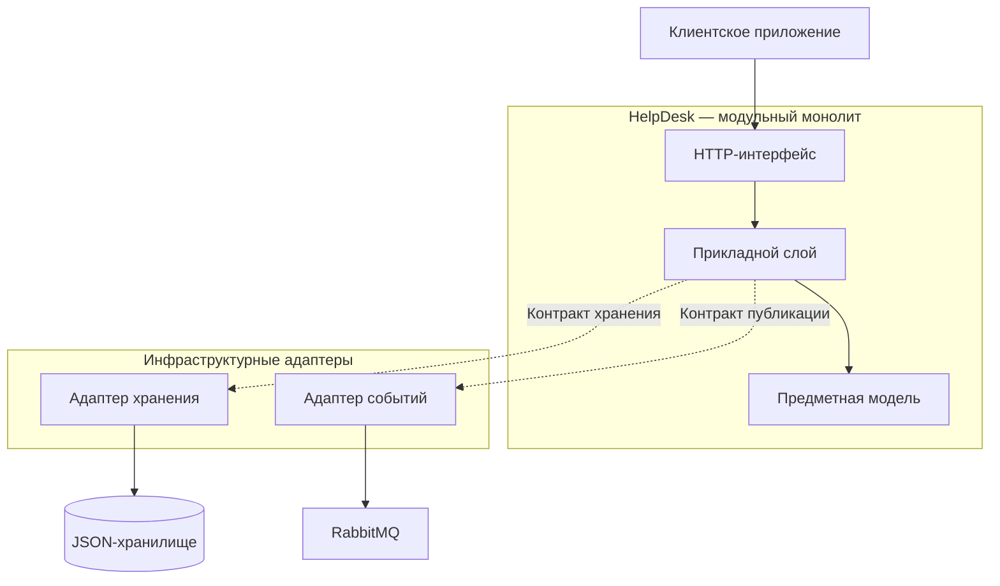

# Архитектура приложения HelpDesk

## Архитектурный подход

Модульный монолит с разделением ответственности
по архитектурным слоям.

## Основные компоненты

- HTTP-интерфейс — приём запросов и выдача ответов.
- Прикладной слой — выполнение сценариев приложения.
- Предметная модель — объекты и правила их поведения.
- Инфраструктура — хранение данных и внешние интеграции.

## Схема компонентов



## Решение ARCH-002

Статус: принято для учебного проекта.

### Принятое решение

Использовать слоистую организацию приложения.

Предметную модель разместить отдельно
от прикладной логики и инфраструктурных компонентов.

Взаимодействие прикладного слоя с инфраструктурой
организовать через программные контракты.

### Структура проекта

```text
helpdesk-system/
├── helpdesk/
│   ├── core.py
│   ├── domain.py
│   ├── application.py
│   ├── adapters.py
│   ├── api.py
│   ├── messaging.py
│   ├── worker.py
│   └── demo.py
├── data/
│   └── tickets.json
├── docs/
│   ├── design/
│   └── architecture/
│       ├── 07-architecture-styles.md
│       ├── 08-architecture-decision.md
│       ├── 09-integration-model.md
│       └── 10-application-architecture.md
├── tests/
│   └── test_architecture.py
└── requirements.txt
```

### Правила зависимостей

domain.py использует стандартную библиотеку Python.

application.py зависит от предметной модели
и объявленных программных контрактов.

adapters.py содержит конкретные реализации
инфраструктурных операций.

api.py создаёт компоненты и связывает их
с прикладным сервисом.

core.py обеспечивает совместимость с прежними
учебными сценариями.

### Последствия решения

Предметная модель может использоваться независимо
от HTTP-интерфейса.

Инфраструктурные реализации могут заменяться.

Прикладные сценарии можно проверять
с использованием временных реализаций зависимостей.

### Текущие ограничения

JSON-хранилище рассчитано на последовательную
обработку операций в учебном окружении.

Сохранение заявки и публикация события выполняются
как отдельные операции.

Согласованность при сбоях и одновременной работе
нескольких процессов требует дальнейшей проработки.
