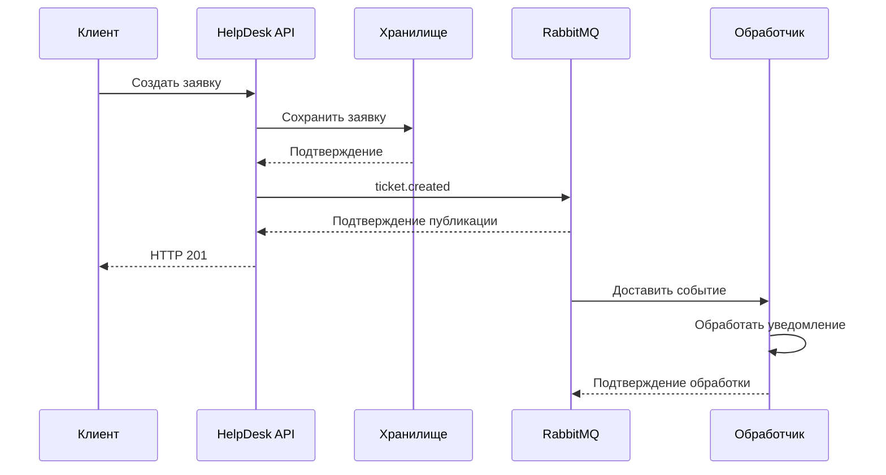

# Интеграционный контракт HelpDesk

## Событие создания заявки

Название: ticket.created
Версия: 1

```json
{
  "event_id": "evt-001",
  "event_type": "ticket.created",
  "version": 1,
  "occurred_at": "2026-11-18T12:00:00+00:00",
  "data": {
    "ticket_id": "ticket-001",
    "title": "Не работает принтер"
  }
}
```

## Участники взаимодействия

Источник: приложение HelpDesk.

Получатель: обработчик уведомлений.

Транспорт: RabbitMQ.

Очередь: helpdesk.notifications.

Формат: JSON в кодировке UTF-8.

## Последовательность взаимодействия


