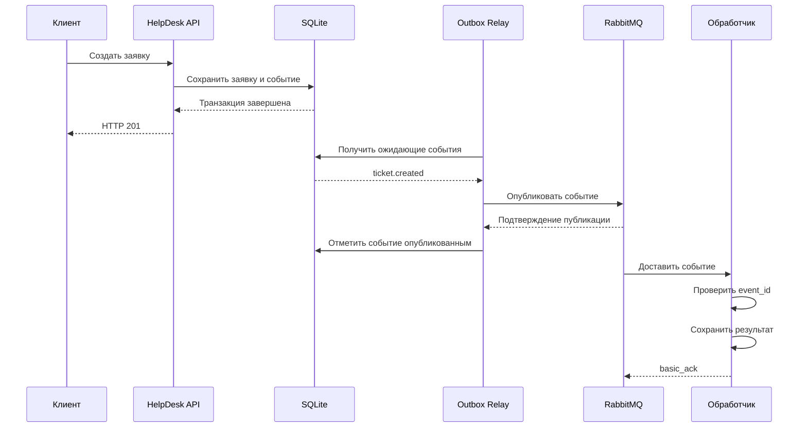

# Надёжность интеграции HelpDesk

## Решение INT-001

Статус: принято для учебного проекта.

## Общая схема взаимодействия

## Требования к взаимодействию

- Создание заявки должно завершаться после
  успешного сохранения заявки и события.
- Временная недоступность RabbitMQ должна
  допускать последующую публикацию.
- Повторная доставка события должна
  сохранять корректность данных получателя.
- События должны иметь уникальные идентификаторы.
- Результаты публикации и обработки
  должны фиксироваться отдельно.

## Контрольные состояния

| Ситуация                      | Ожидаемое поведение           |
| ----------------------------- | ----------------------------- |
| RabbitMQ недоступен           | Событие ожидает публикации    |
| Публикация подтверждена       | Outbox получает отметку       |
| Сообщение доставлено повторно | Повторная запись пропускается |
| Обработка завершена           | Отправляется basic_ack        |
| Обработчик завершился до ack  | Возможна повторная доставка   |

## Ограничения реализации

Outbox Relay запускается вручную.

Один процесс последовательно публикует события.

Для параллельной публикации необходимы
механизмы координации обработчиков.

Промышленная эксплуатация требует мониторинга,
повторных попыток с задержками и обработки
неисправимых сообщений.

Для внешних побочных эффектов требуется
отдельная стратегия идемпотентности.
