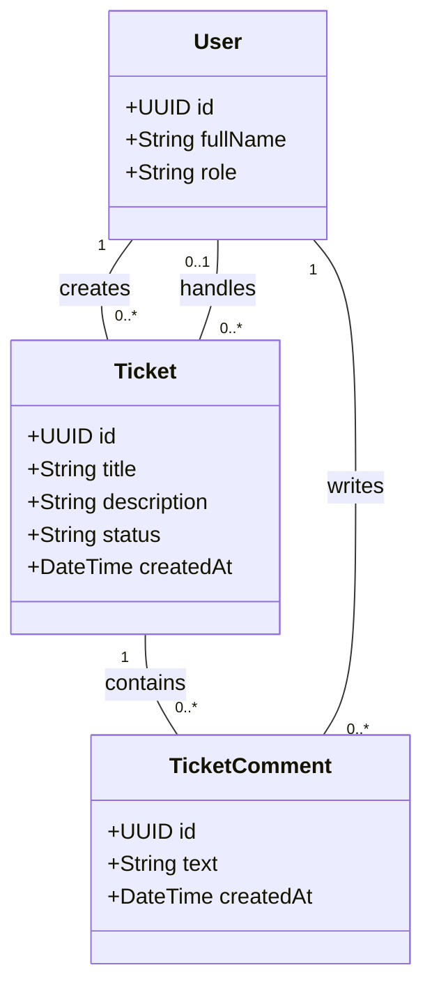

# Информационная модель HelpDesk

## Предметная область

Система предназначена для регистрации
и обработки заявок технической поддержки.

## Основные сущности

### User

Пользователь системы. Может выступать сотрудником,
специалистом поддержки или руководителем.

### Ticket

Заявка на техническую поддержку.
Содержит описание проблемы и сведения
о текущем состоянии обработки.

### TicketComment

Комментарий к заявке.
Используется для фиксации сообщений,
связанных с обработкой обращения.

## Исходное проектное правило

В соответствии с DEC-001 заявка может
существовать без назначенного исполнителя.

## Структура классов

