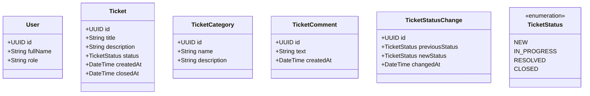

# Базовая информационная модель HelpDesk

## Назначение модели

Описание объектов и связей, необходимых
для регистрации и обработки заявок.

## Состав информационной модели

User — пользователь системы.

Ticket — заявка технической поддержки.

TicketCategory — категория обращения.

TicketComment — комментарий к заявке.

TicketStatusChange — изменение статуса заявки.

TicketStatus — набор допустимых состояний заявки.

## Дополнительные правила

Каждая заявка относится к одной категории.

Каждая заявка имеет одного автора.

Заявка может существовать без исполнителя.

Изменения статусов должны сохраняться в истории.

Каждое изменение статуса связано с пользователем,
выполнившим операцию.

## Диаграмма классов

