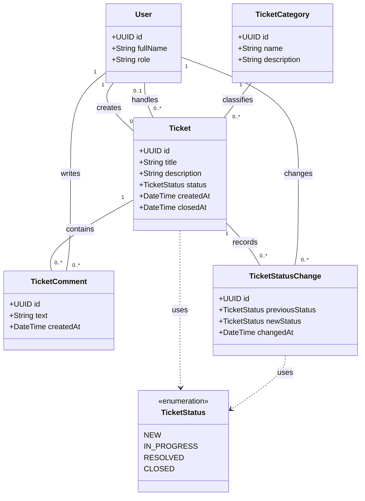

# Базовая информационная модель HelpDesk

## Назначение модели

Описание объектов и связей, необходимых
для регистрации и обработки заявок.

## Состав информационной модели

User — пользователь системы.

Ticket — заявка технической поддержки.

TicketCategory — категория обращения.

TicketComment — комментарий к заявке.

TicketStatusChange — изменение статуса заявки.

TicketStatus — набор допустимых состояний заявки.

## Дополнительные правила

Каждая заявка относится к одной категории.

Каждая заявка имеет одного автора.

Заявка может существовать без исполнителя.

Изменения статусов должны сохраняться в истории.

Каждое изменение статуса связано с пользователем,
выполнившим операцию.

## Диаграмма классов

## Проверочный сценарий

Сотрудник Анна создаёт заявку
«Не включается ноутбук».

Категория: Оборудование.
Начальный статус: NEW.
Исполнитель: отсутствует.

Руководитель назначает специалиста Олега.

Олег добавляет комментарий:
«Проверяю подключение питания».

Олег переводит заявку из NEW в IN_PROGRESS.

Система сохраняет изменение статуса
с указанием пользователя и времени операции.

## Ожидаемое состояние модели

Ticket:

- имеет одного автора;
- связан с категорией;
- связан с исполнителем Олегом;
- имеет статус IN_PROGRESS;
- содержит один комментарий;
- содержит одну запись истории изменения статуса.

TicketComment:

- связан с заявкой;
- имеет автора Олега.

TicketStatusChange:

- предыдущий статус NEW;
- новый статус IN_PROGRESS;
- пользователь Олег;
- время изменения зафиксировано.
