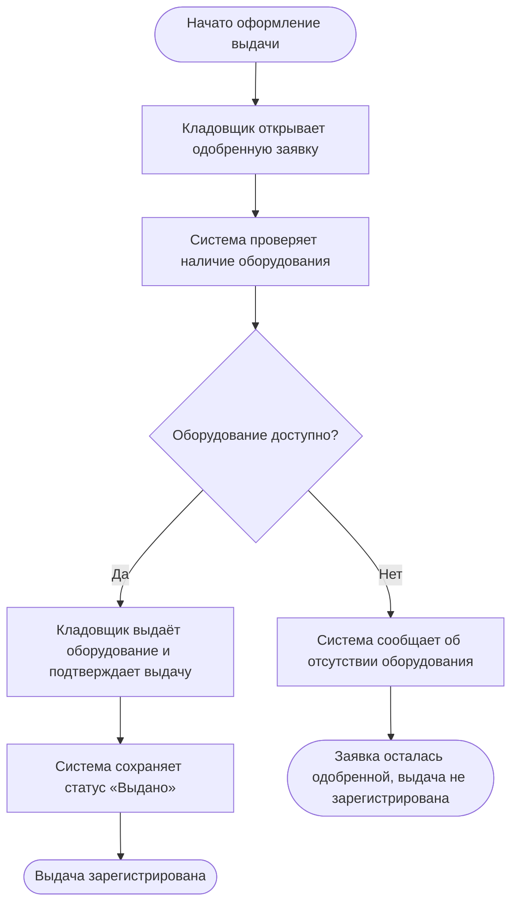
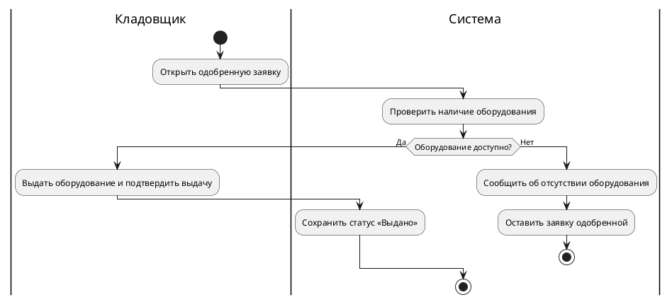

# Практическое задание «Моделирование процесса и Use Case»

**Темы курса** — 2.4–2.6 «Моделирование бизнес-процессов в EPC, eEPC и BPMN» и 2.8–2.9 «Документирование требований с помощью Use Case».

Практика для самостоятельного закрепления навыков. Сдача по желанию.

## Цель

Описать одну операцию в двух представлениях. Диаграмма процесса покажет участников, порядок действий и развилку. Текстовый Use Case опишет, как пользователь взаимодействует с системой, чтобы получить результат, и что происходит при исключении.

## Задание

### Шаг 1. Выберите одну операцию

Возьмите результаты интервью и выберите операцию, в которой участвуют пользователь и система. Например, рассмотрение разовой заявки на бронирование аудитории. [Задание по выявлению требований](./01-2.3-Практическое-задание-Выявление-требований.md).

Для самостоятельного старта можно взять следующие учебные условия. Координатор уже подал заявку. Администратор открывает её и проверяет доступность аудитории на нужное время. Если интервал свободен, администратор подтверждает заявку. Если занят, администратор отклоняет её. Сервис сохраняет решение и показывает его координатору. В этом варианте опишите работу будущего сервиса с момента открытия заявки администратором до сохранения и отображения решения.

Можно выбрать другой учебный или рабочий процесс. Ограничьте его одной операцией. Запишите её название, событие начала, ожидаемый результат и источник правил. Если какое-то правило вы задали для учебной модели, отметьте его как допущение.

### Шаг 2. Разложите процесс на действия

1. Выпишите участников и то, что делает каждый. Отдельно обозначьте действия пользователя и действия, которые выполняет система.
2. Запишите обычный ход в порядке выполнения. Для каждого шага укажите, кто действует, что делает и какой результат получает.
3. Найдите точку, в которой ход процесса может измениться. Запишите условие перехода на другую ветвь, действия на ней и её итог. Для первой попытки достаточно одной развилки с двумя исходами.
4. Проверьте границы. У каждой ветви должен быть понятный конец или явный возврат к определённому шагу.

Для черновика подойдут четыре колонки — **Шаг**, **Участник**, **Действие** и **Результат или условие**. Из этого списка вы построите диаграмму и возьмёте шаги для Use Case.

### Шаг 3. Постройте диаграмму из кода

Выберите **Mermaid** или **PlantUML**. Диаграмма из кода (*diagram as code*) хранится в виде текста, из которого редактор строит изображение. Для основной части достаточно одной диаграммы. Flowchart в Mermaid и диаграмма деятельности в PlantUML подходят для передачи логики процесса. Формальную модель BPMN или EPC можно построить по расширенным рекомендациям ниже.

- **Mermaid.** Откройте редактор, вставьте пример из подсказок и убедитесь, что видите схему. Замените подписи и связи своим сценарием. В подписях к действиям укажите роль. Сохраните исходный текст в файле `.mmd` или в Markdown-блоке с языком `mermaid`. [Mermaid Live Editor](https://mermaid.live/) · [Синтаксис блок-схем Mermaid](https://mermaid.js.org/syntax/flowchart.html).
- **PlantUML.** Откройте редактор или средство предварительного просмотра, вставьте пример целиком и проверьте результат. Замените дорожки, действия и условия своими. Сохраните код от `@startuml` до `@enduml` в файле `.puml`. [Онлайн-редактор PlantUML](https://www.plantuml.com/plantuml/uml/) · [Синтаксис диаграммы деятельности](https://plantuml.com/ru/activity-diagram-beta).

Пройдите по обеим ветвям на отрисованной схеме. Убедитесь, что подписи показывают, кто действует, при каком условии меняется ход и чем всё заканчивается.

### Шаг 4. Напишите текстовый Use Case

Возьмите ту же операцию, но опишите её с точки зрения взаимодействия пользователя с системой. Для примера с бронированием основным участником будет администратор, который хочет рассмотреть заявку. Используйте следующую структуру.

| Поле | Что записать |
| --- | --- |
| Идентификатор и название | Например, `UC-01` и краткое название действия. |
| Цель и основной участник | Кто запускает сценарий и какого результата хочет добиться. |
| Предусловия | Что уже должно быть выполнено до начала. Например, заявка уже подана и доступна администратору. |
| Событие запуска | Какое действие или событие начинает сценарий. |
| Основной ход | Пронумерованные действия пользователя и ответы системы при обычном исходе. |
| Альтернативный ход | Номер шага, на котором ход меняется, условие, действия пользователя и системы, результат или номер шага для возврата. |
| Результат | Что сохранено или показано после каждой ветви. Если у заявки меняется статус, укажите его. |
| Источник правил | Номер требования из задания по выявлению требований, ссылка на заметку интервью или учебное условие из шага 1. |

### Шаг 5. Соберите результат

Сохраните исходный код диаграммы и текстовый Use Case. Если код и описание лежат в разных файлах, добавьте ссылку между ними. Рядом с кодом можно сохранить изображение диаграммы для просмотра. Сверьте два представления по трём пунктам — одинаково ли описаны начало операции, условие развилки и результат каждой ветви.

## Подсказки по ключевым частям

- **Действие** называйте глаголом с объектом, например «Проверить наличие». **Событие** описывает уже наступившее состояние, например «Заявка получена».
- **Развилку** формулируйте как проверяемое условие. Подписи на выходах должны объяснять, в какой ситуации выбирается каждая ветвь.
- **Предусловие** должно быть выполнено до запуска. Если пользователь вводит данные или система проверяет их в ходе операции, укажите это в шагах.
- **Альтернативный ход** привяжите к конкретному шагу основного хода. Например, если на шаге 2 система проверяет наличие, ветвь отсутствия начинается со шага 2.

### Пример для другой предметной области

В примере кладовщик оформляет выдачу оборудования по уже одобренной заявке. Обе диаграммы передают один сценарий.

**Mermaid**

**PlantUML**

**Фрагмент Use Case для этого примера**

- **UC-01 — Выдать оборудование по заявке.** Основной участник — кладовщик. Предусловие — существует одобренная заявка.
- **Основной ход.** На шаге 1 кладовщик открывает заявку. На шаге 2 система проверяет наличие. На шаге 3 кладовщик выдаёт оборудование и подтверждает выдачу. На шаге 4 система сохраняет статус «Выдано».
- **Альтернативный ход 2а.** Если на шаге 2 оборудования нет, система сообщает об этом и завершает сценарий. Заявка остаётся одобренной, выдача не регистрируется.

## Расширенные рекомендации

Если хотите отработать формальную нотацию, перенесите готовый сценарий в один из редакторов ниже. Используйте те же границы, участников, условия и результаты ветвей, чтобы можно было сопоставить диаграммы.

### Camunda Modeler — BPMN

1. Откройте Camunda Desktop Modeler и на стартовом экране выберите **BPMN diagram**. На полотне появится начальное событие. Подпишите событие, которое запускает ваш процесс. [Установка Desktop Modeler](https://docs.camunda.io/docs/components/modeler/desktop-modeler/install-the-modeler/) · [Создание диаграммы](https://docs.camunda.io/docs/components/modeler/desktop-modeler/model-your-first-diagram/).
2. Добавьте задачи с помощью палитры слева или меню рядом с выбранным элементом. Для одного процесса можно добавить пул, а внутри него дорожки для ролей. Разместите каждую задачу на дорожке ответственного. Соедините шаги внутри пула потоком управления (**Sequence Flow**). Для обмена сообщениями между отдельными пулами используйте **Message Flow**. [Справочник элементов BPMN](https://camunda.com/bpmn/reference/).
3. После задачи, на которой проверяется условие, добавьте исключающий шлюз (**Exclusive Gateway**). Подпишите две выходящие стрелки условиями выбора и проведите каждую ветвь до результата. Для учебной схемы достаточно показать условия на диаграмме. [Исключающий шлюз в BPMN](https://docs.camunda.io/docs/components/modeler/bpmn/exclusive-gateways/).
4. Добавьте конечные события. Проверьте, что по схеме можно пройти от начала к итогу любой ветви. Сохраните модель через **File → Save As** в файле `.bpmn` и откройте его повторно, чтобы проверить сохранение. [Сохранение диаграммы](https://docs.camunda.io/docs/components/modeler/desktop-modeler/model-your-first-diagram/).

### Bee-Up — EPC или eEPC

1. Откройте Bee-Up и перейдите в компонент **Modelling**. Выберите **Model → New…**, отфильтруйте модели по **Event-driven Process Chain**, выберите тип модели EPC, введите название и выберите группу, в которой будет сохранена модель. Нажмите **Create**. [Страница Bee-Up](https://bee-up.omilab.org/activities/bee-up/) · [Руководство Bee-Up](https://bee-up.omilab.org/home/docs/Bee-Up_Handbook_1.7.pdf#page=9).
2. Начните с элемента **Event** для исходного состояния. Добавьте **Function** для первого действия и ещё одно событие для его результата. Продолжайте чередовать события и функции. Соединяйте шаги связью **Subsequent**. [Раздел руководства по EPC](https://bee-up.omilab.org/home/docs/Bee-Up_Handbook_1.7.pdf#page=18).
3. После функции, в которой проверяется условие, добавьте **XOR operator**. На выходах обозначьте события для взаимоисключающих результатов проверки. Продолжите каждую ветвь до конечного события. Если нужно показать исполнителей или информационные объекты, переключитесь через **View → Mode → eEPC** и свяжите эти элементы с соответствующими функциями. [Раздел руководства по EPC и eEPC](https://bee-up.omilab.org/home/docs/Bee-Up_Handbook_1.7.pdf#page=18).
4. Сохраните модель. Для передачи редактируемой модели перейдите в **Import/Export** и выберите **Model → ADL export → Models/Attribute profiles…**. Для изображения в компоненте **Modelling** используйте **Edit → Generate graphics → Region…**. [Экспорт модели и изображения](https://bee-up.omilab.org/home/docs/Bee-Up_Handbook_1.7.pdf#page=13).

## Что проверить перед отправкой

Используйте чек-лист для самопроверки или перед отправкой, если решите поделиться результатом.

- [ ] Выбрана одна операция и указан источник её правил.
- [ ] На диаграмме видны начало, участники, основной ход и хотя бы одна альтернативная ветвь с условием и результатом.
- [ ] Исходный код диаграммы сохранён и открывается в выбранном редакторе.
- [ ] В Use Case указаны основной участник, цель, предусловия, запуск и результат.
- [ ] Альтернативный ход связан с конкретным шагом основного сценария.
- [ ] На диаграмме и в Use Case совпадают условие развилки и итог каждой ветви.

## Советы по улучшению работы

- Проверьте диаграмму по одному примеру для каждого исхода. Если на каком-то шаге непонятно, кто принимает решение, добавьте роль или уточните условие.
- Если схема получилась большой, выделите одну пользовательскую цель и оставьте шаги, которые нужны для её достижения.
- В Use Case указывайте видимый результат действия. Например, запишите, какой статус система сохраняет и что видит пользователь.
- Для расширенного варианта сравните свою схему из кода с BPMN или EPC. Проверьте, помогла ли формальная нотация точнее показать ответственность, событие или развилку.

## Вопросы для рефлексии

1. Почему вы выбрали именно эти начало и конец операции?
2. Какое правило стало понятнее после того, как вы нарисовали развилку?
3. Какой шаг было легче объяснить в Use Case, чем на диаграмме?
4. Что в вашей модели зависит от допущения и как его можно проверить?
5. Что вы бы уточнили, чтобы человек, впервые увидевший модель, смог пройти по обеим ветвям без дополнительных пояснений?
