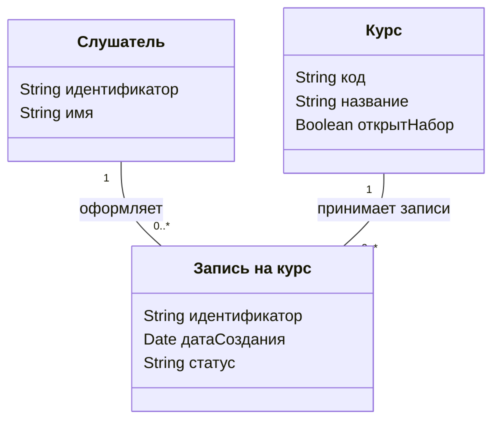
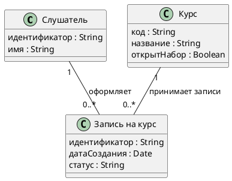

# Практическое задание «Проектирование информационной модели»

**Темы курса** — 3.1 «Этапы, задачи и виды проектирования ПО», 3.2 «Проектирование информационной модели приложения. Объектно-ориентированный подход» и 3.3 «Разработка базовой информационной модели».

Практика для самостоятельного закрепления навыков. Сдача по желанию.

## Цель

Перейти от описания одного сценария к информационной модели. Выделить объекты, сведения о них и связи, построить диаграмму классов и проверить, что модель отражает два правила предметной области.

## Задание

### Шаг 1. Выберите сценарий и зафиксируйте его границы

Это первый этап итогового проекта. Выберите одну операцию, которую будете развивать до защиты. Подойдёт действие, которое меняет данные и даёт наблюдаемый результат, например подтверждение заявки. Можно взять его из своего Use Case или начать с кейса ниже. Запишите, с какого события начинается сценарий, чем заканчивается и какое исключение важно учесть. Для кейса «Север» используйте утверждённые требования выбранного релиза. В задании № 3 исходный объём R1 описан в версии B1. [Задание № 2 с Use Case](./02-Практическое-задание-Моделирование-процесса-и-Use-Case.md) · [Задание № 3 по управлению изменениями](./03-2.12-Практическое-задание-Управление-изменениями-и-трассировка.md).

**Условия для самостоятельного старта.** Возьмите рассмотрение разовой заявки на бронирование. Заявка уже подана на одну аудиторию и содержит время начала и окончания. В начале сценария администратор открывает заявку на рассмотрении. При подтверждении появляется бронь на запрошенный интервал. При отклонении фиксируется решение по заявке. До подтверждения заявка может быть отозвана. Интервалы подтверждённых броней одной аудитории могут быть смежными, а пересечение интервалов запрещено. Для этого упражнения рассматривайте интервалы, на которые нет служебных закрытий.

Можно взять другой учебный или рабочий процесс. В начале своего документа укажите выбранную операцию, источник правил и допущения. Для работы в онлайн-редакторе используйте учебные или обезличенные примеры.

### Шаг 2. Выделите объекты предметной области

1. Перечитайте сценарий и выпишите, о каких объектах системе нужны сведения. Для первой попытки обычно достаточно 3–5 классов.
2. Для каждого кандидата укажите, что он представляет и зачем сведения о нём нужны в выбранной операции. Например, заявка хранит сведения о запросе пользователя, а аудитория описывает ресурс, который можно забронировать.
3. Дайте каждому классу короткое имя в единственном числе. У класса может быть много экземпляров. Например, «Аудитория» — класс, а аудитория А-204 — один экземпляр.
4. Если в сценарии есть роль, проверьте, нужны ли модели сведения о человеке в этой роли. Добавьте класс, когда сценарий использует его данные, например хранит автора заявки или проверяет права на действие.

### Шаг 3. Опишите атрибуты

Атрибут — свойство объекта. Для каждого класса выпишите несколько свойств, которые нужны в выбранном сценарии. Начните с признака, по которому можно отличить один экземпляр от другого, затем добавьте данные, необходимые для проверки условия или записи результата.

- Укажите смысл и тип значения. Например, время начала — дата и время, а номер аудитории — текст, поскольку он может содержать буквы и дефис.
- Для статуса перечислите допустимые значения, которые встречаются в вашей модели.
- Отметьте свойства, обязательные для конкретной операции. Если значение появляется позже, укажите, на каком шаге оно становится известно.

Для черновика используйте колонки **Класс**, **Атрибут**, **Тип** и **Зачем нужен**. В диаграмме достаточно показать имена и типы атрибутов.

### Шаг 4. Проведите связи и укажите кратности

Свяжите классы, экземпляры которых относятся друг к другу. Подпишите связь глаголом или короткой фразой, чтобы её смысл читался из диаграммы. Затем определите **кратность** на обоих концах связи. Она показывает, сколько экземпляров класса у этого конца может быть связано с одним экземпляром класса на противоположном конце. [Кратности в диаграммах классов Mermaid](https://mermaid.js.org/syntax/classDiagram#cardinality-multiplicity-on-relations).

| Кратность | Как читать |
| --- | --- |
| `1` | Ровно один экземпляр. |
| `0..1` | Экземпляр может отсутствовать, допустим максимум один. |
| `0..*` | Может быть ни одного, один или несколько экземпляров. |
| `1..*` | Должен быть хотя бы один экземпляр. |

Проверьте обе стороны каждой связи на примере. Для связи заявки с бронью уточните, может ли заявка существовать до появления брони и может ли бронь появиться без исходной заявки. Если источник допускает разные варианты, запишите выбранный вариант как допущение.

### Шаг 5. Запишите два правила и проверьте модель

1. Выберите два правила, от которых зависит результат сценария. Для каждого запишите, что разрешено или запрещено, и укажите источник — требование, условие задания или допущение.
2. Укажите, как каждое правило отражено в модели. Кратность может показать, сколько объектов связано. Условия по значениям атрибутов или их сочетанию удобнее фиксировать текстом рядом с диаграммой.
3. Проверьте модель на двух небольших ситуациях. Для кейса «Север» можно разобрать успешное подтверждение и попытку подтвердить заявку на уже занятый интервал. В каждой ситуации запишите, какие объекты существуют до операции, что появляется или меняется после неё и какое правило определяет результат.

### Шаг 6. Постройте диаграмму и соберите результат

Выберите **Mermaid** или **PlantUML**. Достаточно одной диаграммы классов. Вставьте пример из следующего раздела в редактор, убедитесь, что он отображается, и замените классы, атрибуты и связи своими.

- **Mermaid.** Сохраните текст от `classDiagram` в файле `.mmd` или в Markdown-блоке с языком `mermaid`. [Mermaid Live Editor](https://mermaid.live/) · [Синтаксис диаграмм классов](https://mermaid.js.org/syntax/classDiagram).
- **PlantUML.** Сохраните текст от `@startuml` до `@enduml` в файле `.puml`. [Онлайн-редактор PlantUML](https://www.plantuml.com/plantuml/uml/) · [Синтаксис диаграмм классов](https://plantuml.com/class-diagram).

Создайте папку итогового проекта и сохраните в ней описание сценария и информационную модель. Укажите название сценария, границы и источник правил. Добавьте исходный код диаграммы, два правила с пояснением, как они отражены в модели, и результаты двух проверок. Отдельно укажите допущения, от которых зависят связи или правила. В следующих заданиях используйте этот сценарий и сохраняйте результаты в ту же папку или репозиторий проекта.

## Подсказки по ключевым частям

- **Объект или атрибут.** Если сведения описывают свойство одного объекта, начните с атрибута. Если у понятия есть собственные свойства и связи, рассмотрите отдельный класс.
- **Связь или шаг процесса.** Диаграмма классов показывает, какие объекты связаны. Последовательность действий возьмите из Use Case и используйте для проверки модели.
- **Кратность или правило.** Кратность отвечает на вопрос о количестве. Например, у одного курса может быть много записей, а ограничение на повторную активную запись одного слушателя задаётся отдельным правилом.

### Пример для сервиса записи на курсы

В примере «Запись на курс» — отдельный класс, поскольку у записи есть дата и статус. У каждой записи ровно один слушатель и один курс. У слушателя или курса пока может не быть ни одной записи.

**Mermaid**

**PlantUML**

**Пример правил для этой модели**

1. Создать запись можно, пока у курса открыт набор. Для проверки используется атрибут `открытНабор`.
2. У слушателя может быть максимум одна активная запись на тот же курс. Правило проверяется по связям записи с курсом и слушателем и по атрибуту `статус`.

**Пример проверки.** В обеих ситуациях набор на курс открыт. Если у слушателя ещё нет активной записи на этот курс, новая запись допустима. Если активная запись уже существует, вторую создать нельзя. Кратности на диаграмме одинаковы для обеих ситуаций, а результат определяет второе правило.

## Что проверить перед отправкой

Используйте чек-лист для самопроверки или перед отправкой, если решите поделиться результатом.

- [ ] Указаны границы одного сценария, источник правил и важные допущения.
- [ ] У каждого класса есть понятное название и сведения, необходимые для сценария.
- [ ] Связи подписаны, а кратности читаются в обе стороны.
- [ ] Записаны два бизнес-правила и понятно, на каких объектах, связях или атрибутах они основаны.
- [ ] Модель проверена на двух ситуациях, и результат каждой зафиксирован.
- [ ] Исходный код диаграммы сохранён, диаграмма отображается в выбранном редакторе.

## Советы по улучшению работы

- Прочитайте каждую связь обычным предложением в обе стороны. Так проще заметить перепутанные кратности.
- Проверьте пограничную ситуацию. Для временных интервалов сравните смежные интервалы с пересекающимися.
- Если на диаграмме много классов, сопоставьте каждый с шагом сценария или правилом. Оставьте те, которые помогают объяснить выбранную операцию.

## Вопросы для рефлексии

1. Как вы решили, какие объекты вошли в границы модели?
2. Какое свойство или связь оказалось сложнее всего определить по исходному сценарию?
3. Какой пример помог вам проверить кратность в обе стороны?
4. Какое правило потребовалось описать текстом рядом с диаграммой?
5. Какое допущение вы бы первым уточнили у владельца процесса?
