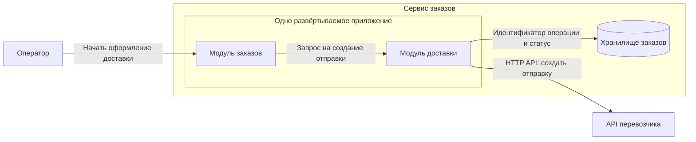
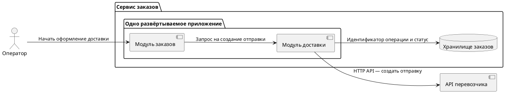
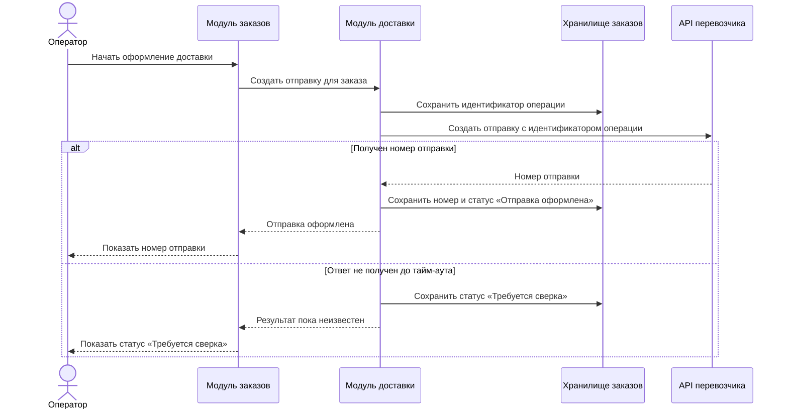
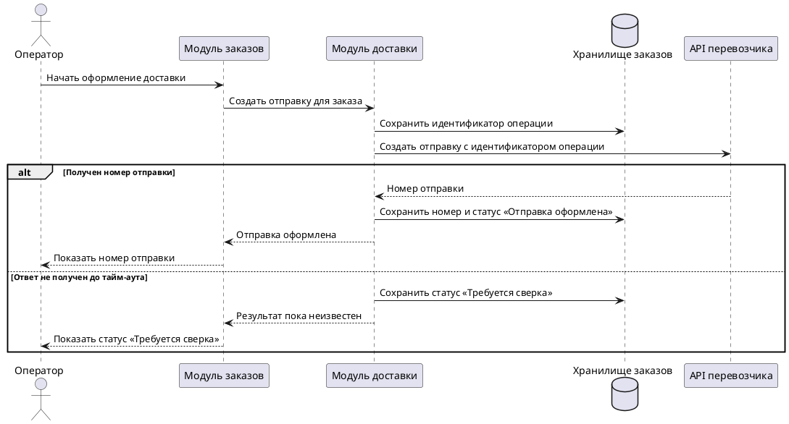

# Практическое задание «Архитектура и интеграции»

**Темы курса** — 3.4 «Архитектура информационных систем. Монолиты, SOA и микросервисы», 3.5 «API и брокеры очередей. Методология интеграции приложений», 3.6 «Разработка архитектуры приложения» и 3.7 «Проработка интеграционного взаимодействия».

Практика для самостоятельного закрепления навыков. Сдача по желанию.

## Цель

Выбрать архитектуру для одного сценария, распределить ответственность между частями системы и описать один обмен данными. На диаграмме последовательности показать успешный обмен и поведение системы при одном сбое.

## Задание

### Шаг 1. Выберите один сценарий и одну интеграцию

Возьмите операцию из предыдущего задания и найдите внешний сервис или другую систему, с которой она обменивается данными. Зафиксируйте, кто запускает операцию, какой результат нужен и какая часть обмена входит в модель. Сохраните названия ключевых объектов из информационной модели. [Задание № 4 «Проектирование информационной модели»](./04-Практическое-задание-Информационная-модель.md).

**Условия для самостоятельного старта.** В учебном центре «Север» администратор принимает решение по разовой заявке на бронирование. Сервис сохраняет решение и отправляет координатору письмо через внешний почтовый сервис. Письмо о решении предусмотрено требованием FR-04 в версии B1. [Исходный кейс задания № 3](./03-2.12-Практическое-задание-Управление-изменениями-и-трассировка.md).

Для этой практики примите три допущения. Решение по заявке сохраняется независимо от результата отправки письма. Письмо может уйти позже. Почтовый сервис иногда не отвечает за отведённое время. Начните модель с действия администратора и закончите фиксацией результата сохранения решения и состояния уведомления.

Можно взять другую учебную или рабочую задачу с одним внешним обменом, например отправку заказа перевозчику или передачу заявки в сервис согласования. Для онлайн-редактора используйте учебные или обезличенные данные.

### Шаг 2. Выберите архитектурный подход

Запишите 2–3 условия, которые влияют на архитектуру. Начните с размера команды, необходимости выпускать части приложения отдельно и наличия общих сервисов, которые уже используются в организации. Если для выбора не хватает сведений, явно запишите, что вы предполагаете.

| Подход | Когда рассмотреть | Что учесть |
| --- | --- | --- |
| Модульный монолит | Основные функции ведёт одна команда и их удобно выпускать вместе. | Модули разделены по ответственности внутри одного развёртываемого приложения. Изменения выходят в составе общего релиза. |
| SOA | Несколько систем организации используют общие бизнес-сервисы. | Нужно согласовать контракты, владельцев сервисов и порядок изменения общих интерфейсов. |
| Микросервисы | Отдельные бизнес-функции нужно выпускать или масштабировать независимо. | У каждой части появляются свои границы и ответственность. Нужно учитывать сетевые сбои, согласованность данных и эксплуатацию нескольких сервисов. |

Выберите один вариант и запишите его обоснование в двух-трёх предложениях. Свяжите решение с конкретными условиями кейса и назовите один компромисс, который придётся принять. [Архитектуры веб-приложений Microsoft](https://learn.microsoft.com/en-us/dotnet/architecture/modern-web-apps-azure/common-web-application-architectures) · [SOA](https://aws.amazon.com/what-is/service-oriented-architecture/) · [Микросервисы](https://learn.microsoft.com/en-us/azure/architecture/guide/architecture-styles/microservices).

### Шаг 3. Постройте схему компонентов

1. Выпишите части системы, которые участвуют в операции. Для каждой кратко запишите ответственность, например сохранить решение по заявке или передать запрос на отправку письма.
2. Отметьте границу своей системы. Пользователя и внешний сервис разместите снаружи. Если выбрали монолит, объедините внутренние модули в одно приложение. Если выбрали отдельные сервисы, покажите их границы и кто отвечает за данные.
3. Добавьте хранилище или другой источник данных, который нужен в сценарии. Покажите, какая часть системы записывает туда результат.
4. Проведите стрелки по направлению вызова или передачи сообщения. Подпишите, что передаётся и каким способом. Для первой схемы обычно достаточно 3–6 блоков, участвующих в операции.

### Шаг 4. Опишите выбранный обмен

Решите, требуется ли результат внешнего вызова сразу. При синхронном вызове через API вызывающая часть ждёт ответ в рамках текущего обмена. При асинхронной передаче через очередь отправитель может продолжить работу после подтверждения приёма сообщения, а обработчик выполняет задачу отдельно. Приём сообщения в очередь и завершение работы обработчика — разные результаты. [Руководство AWS по асинхронному обмену](https://docs.aws.amazon.com/prescriptive-guidance/latest/modernization-integrating-microservices/asynchronous.html).

Оформите короткую карточку одного обмена.

| Поле | Что записать |
| --- | --- |
| Событие запуска | Какое действие или изменение состояния запускает обмен. |
| Участники | Кто отправляет данные и кто их получает. Для очереди укажите также брокер и обработчик. |
| Способ передачи | Вызов API или сообщение в очереди. Укажите, почему этот способ подходит сценарию. |
| Данные | Назовите 3–5 необходимых полей. Для письма это могут быть номер заявки, результат решения, получатель и идентификатор отправки. |
| Признак успеха | Как система узнает, что запрос принят или обработан, и где запишет этот результат. |
| Сбой | Какой сбой вы рассматриваете, что останется сохранённым и кто сможет продолжить работу. |

### Шаг 5. Покажите последовательность и сбой

1. Перенесите участников из схемы компонентов на диаграмму последовательности. Покажите, кто инициирует операцию, когда сохраняется основной результат, как отправляются данные и когда фиксируется итог обмена.
2. Добавьте ветвление с двумя исходами — успешный обмен и один сбой. Для кейса «Север» можно взять тайм-аут при обращении к почтовому сервису. Покажите, какое состояние видит пользователь и что происходит с уже сохранённым решением по заявке.
3. Опишите следующий шаг после сбоя. При тайм-ауте итог внешней операции может быть неизвестен. Если вы предлагаете повторить запрос, укажите, как проверяется предыдущая попытка или как внешний сервис распознаёт повтор той же операции. Если автоматическая проверка и распознавание повтора недоступны, предусмотрите ручную сверку перед новой отправкой. [AWS Builders’ Library о тайм-аутах и повторах](https://aws.amazon.com/builders-library/timeouts-retries-and-backoff-with-jitter/).
4. Если выбрали очередь, покажите, где фиксируется задача на отправку до обработки и где сохраняется её итог. Укажите, что произойдёт при повторном получении того же сообщения. [Руководство AWS по асинхронному обмену](https://docs.aws.amazon.com/prescriptive-guidance/latest/modernization-integrating-microservices/asynchronous.html).

### Шаг 6. Соберите результат

Сохраните исходники **двух диаграмм** — схемы компонентов и диаграммы последовательности. Для каждой можно использовать Mermaid или PlantUML. Добавьте к ним границы сценария, обоснование архитектуры и карточку обмена. Сверьте названия компонентов, направление обмена и итог каждой ветви между схемами и текстом.

- **Mermaid.** Для схемы компонентов используйте `flowchart`, а для обмена — `sequenceDiagram`. Сохраните исходники в файлах `.mmd` или в блоках Markdown с языком `mermaid`. [Редактор Mermaid](https://mermaid.live/) · [Синтаксис блок-схем](https://mermaid.js.org/syntax/flowchart.html) · [Синтаксис диаграмм последовательности](https://mermaid.js.org/syntax/sequenceDiagram.html).
- **PlantUML.** Для схемы используйте компоненты и группы, а для обмена — участников и сообщения. Сохраните исходники от `@startuml` до `@enduml` в файлах `.puml`. [Редактор PlantUML](https://www.plantuml.com/plantuml/uml/) · [Диаграмма компонентов](https://plantuml.com/en/component-diagram) · [Диаграмма последовательности](https://plantuml.com/en/sequence-diagram).

## Подсказки по ключевым частям

- **Компонент** отвечает за определённую часть работы. Например, модуль заявок принимает решение, а модуль уведомлений отвечает за передачу письма.
- **Схема компонентов** помогает увидеть границы, ответственность и направления связи. **Диаграмма последовательности** показывает, в каком порядке участники выполняют действия в одном конкретном сценарии.
- **Архитектура и способ обмена** выбираются отдельно. Внутренние модули могут выпускаться вместе, а внешнее уведомление — обрабатываться позже через очередь.
- **Результаты по отдельности.** В кейсе «Север» решение по заявке и отправка письма имеют отдельные результаты. Уточните, какой результат подтверждает внешний сервис. Например, принятие письма к отправке позволяет отметить принятие, а подтверждение доставки требует отдельного сигнала.

### Пример для магазина

Оператор оформляет доставку уже созданного заказа. Модули заказов и доставки выпускаются вместе. Модуль доставки обращается к API перевозчика, чтобы создать отправку. При отсутствии ответа до тайм-аута оператор видит, что результат требуется сверить.

#### Схема компонентов

**Mermaid**

**PlantUML**

#### Диаграмма последовательности

**Mermaid**

**PlantUML**

В примере следующий шаг при тайм-ауте — сверить с перевозчиком, была ли создана отправка, используя сохранённый идентификатор операции. Доступность такой сверки относится к условиям интеграции, которые нужно подтвердить с владельцем API.

## Что проверить перед отправкой

Используйте чек-лист для самопроверки или перед отправкой, если решите поделиться результатом.

- [ ] Границы сценария и допущения записаны. Выбор архитектуры связан с конкретными условиями.
- [ ] На схеме видны границы системы, ответственность компонентов и направление связей.
- [ ] В карточке обмена указаны участники, способ передачи, основные данные и признак успеха.
- [ ] На диаграмме последовательности видны успешный исход и один сбой.
- [ ] Для сбоя понятно, какой результат сохранён, что видит пользователь и как продолжить работу.
- [ ] Исходники обеих диаграмм сохранены и отображаются в выбранном редакторе.

## Советы по улучшению работы

- Проверьте названия блоков и участников. Один и тот же компонент на обеих диаграммах должен называться одинаково.
- Попробуйте пройти по ветви сбоя отдельно. Отметьте момент, в который возникает неопределённость, и какие сведения помогают разобраться в результате.
- Если схема стала большой, вернитесь к выбранной операции. Покажите части, от которых зависит её результат или обработка сбоя.

## Вопросы для рефлексии

1. Какое условие кейса сильнее всего повлияло на выбор архитектуры?
2. По какому признаку вы определили границу своей системы?
3. Что пользователь может считать завершённым до получения результата внешнего обмена?
4. Какая информация поможет выяснить итог операции после тайм-аута?
5. При каком изменении условий вы бы пересмотрели способ обмена?
